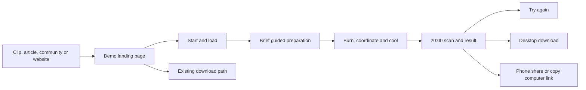

# Under Two Skies browser demo PRD

Version 0.1, prepared 3 October 2026, Asia/Bangkok. Status: implementation proposal, with measured initial feasibility. Product owner: the game owner. Companion: [Browser demo feasibility](BROWSER_DEMO_FEASIBILITY_20261003.md). This specification defines a browser marketing channel that lets people experience the game before downloading its desktop version. **Phone and desktop are required at launch**, as requested by the owner.

## 1 Product decision

Build one free, bounded, replayable afternoon in the browser. Let players prepare a firebreak, coordinate the crew, burn for the harvest and cool the field before the 20:00 satellite pass. Give them a complete result, then invite them to continue with the desktop game. The experience must be satisfying even when they decline the invitation.

Use the current Godot gameplay as the initial implementation route. An isolated web export has reached the hillside in the local browser; that evidence supports a prototype, not a public-ready demo. Final architecture is gated by real Android/iPhone tests and startup size. If optimized 3D cannot pass, evaluate one 2D adaptation serving both phone and desktop. Do not ship a phone-specific unrelated minigame alongside a different desktop demo.

### Goals

1. Let an interested visitor play without an account, email, installer or app-store step.
2. Demonstrate the actual appeal of tactical fire management and mutual aid.
3. Increase qualified interest in the desktop game, with device-appropriate next steps.
4. Make the channel observable enough to identify loading, understanding and conversion problems.

### Boundaries

The initial product includes one scenario and unrestricted retries. It excludes the multiyear campaign, village economy and upgrade menus, multiplayer, public leaderboards, cloud saves, prizes, daily challenges, ads and payments. Desktop campaign content supplies the reason to continue. Mobile browser support does not mean an Android/iOS native release exists.

The existing Steam/itch demo proposal is a separate distribution product. Shared scenario work may benefit it, but the browser demo has a shorter acquisition journey, touch requirements and stricter startup budgets. Existing full-beta downloads remain clearly versioned.

## 2 Audience and acquisition

| Audience | Likely entry | What they need to decide |
| --- | --- | --- |
| Thai phone visitor | Facebook, short video, community post or news article | Can I understand and enjoy this in my browser, then return on a computer? |
| Desktop strategy/survival player | Gameplay clip, game website or creator link | Do these decisions interest me enough to download? |
| International phone/desktop visitor | English captions or article | Does the English presentation explain the rules and cultural context accurately? |

These are audience hypotheses, not measured channel shares. Preserve campaign source and language where available. Prioritize the owner's existing Thai network for early learning, then expand to wider traffic after phone usability and load checks.

Proposed website promise: “Try one afternoon. Prepare the field, lead your crew, and cool the embers before the satellite passes.” Thai candidate: “ลองเล่นหนึ่งบ่าย เตรียมแนวกันไฟ ช่วยกันทำงาน และดับถ่านร้อนก่อนดาวเทียมผ่าน”. Both need editorial and cultural review before public copy is finalized. Public entry copy should say roughly how long a first run takes and that the full game continues on computer.

## 3 Player journey

| State | Player experience | Required behavior |
| --- | --- | --- |
| Landing | Approved logo, real gameplay preview, short premise, estimated play/data requirement, language choice | Small HTML page loads before game assets; Play is primary, desktop download remains available |
| Start | Explicit Play action starts the game download and enables audio when permitted | Visible progress, cancel/retry, no automatic large fetch on page visit |
| Orientation | Phone visitor can rotate before gameplay | Portrait shows accessible instructions; landscape play fits browser bars and safe areas; no forced fullscreen dependency |
| Preparation | Two goals and a few actions taught in context | Clock paused during required tutorial steps; player starts using the firebreak tool |
| Afternoon | Fire, wind and crew decisions produce readable consequences | No marketing popups over action; help and pause remain available |
| Scan | The 20:00 pass checks the field | Clear detected-hotspot result, preserved dramatic moment |
| Result | Ash percentage, hotspots, containment and one useful tip | Same continuation opportunity on success or failure; replay available without another large download |
| Continuation | Interested player takes the next step | Desktop gets platform download; phone gets computer-link copy/share and honest explanation |
| Unsupported/error | Player learns why it cannot start | Working fallback with gameplay preview and computer link; no blank canvas or reload loop |

Browser Back should allow leaving the demo. Switching tab, locking the phone, orientation changes and opening the share sheet must not keep the afternoon progressing unseen. Resume through a visible “Continue” action after an interruption. Reset held movement/tool inputs on interruption so that a returning player cannot accidentally keep igniting.

## 4 Scenario and gameplay

### One representative afternoon

Start with Year 1, plot 1 as the technical reference. It already has gentler terrain, modest bamboo and no drone in Year 1. The public demo uses a reviewed fixed scenario derived from it, with a reproducible scenario version and seed. Seed alone is insufficient for full reproducibility: wind, fire randomness, decorative generation and audio selection must use separated random streams or explicitly recorded inputs so decoration cannot change game outcomes.

Keep the 14:00–20:00 window, all three tools, both autonomous companions, water/refill, wind, field containment and the satellite result. Retain the cultural premise of rotational farming and mutual aid. The target is sufficient cooled ash to support the harvest and no hotspots above the scenario's thermal threshold at the pass. Use the existing 75% ash target initially; verify difficulty with phone input before changing it. A result can distinguish harvest, thermal detection and containment rather than collapsing all failures into a single score.

No ground cameras, rangers, drones, checkpoints or campaign failure cinematics in the initial scenario. Explain their existence, together with village decisions and later seasons, on the full-game comparison card using only currently implemented features. The single-afternoon result must not present a whole village starving or being raided because a new player made one training mistake.

### Session duration

The source reference takes nine minutes for the afternoon. Preserve that reference for the first prototype. Proposed public target: **five to six active minutes for the afternoon**, approximately six to eight minutes including tutorial and result reading; paused/background time is excluded. This is a proposed product target requiring validation, not current behavior.

A demo timing profile must own the clock, fire/smolder durations and relevant crew/tool/resource pacing together. Preserve relative cooling decisions and recompute any displayed self-cooling deadline. Validate three useful paths: a competent run can meet both goals, an early ignition can struggle in damp fuel, and a late ignition leaves meaningful cleanup pressure. Keep the actual satellite pass at 20:00. Avoid creating an impossible field simply by speeding the clock.

The first guided actions are: move to the highlighted reachable area, complete a firebreak cell, select the torch and ignite a deliberate target, then select the sprayer and extinguish a highlighted flame/ember. Use staging if necessary to demonstrate spraying without consuming the real run's resources. Guidance is dismissed immediately when its action completes. A skippable brief context explanation precedes play; the existing full opening film is available as optional context outside the startup-critical pack.

Companions continue to help without compulsory micromanagement. Use one obvious rally control. First-round water and breath are separate meters, with labels and distinct icons. Show the refill point early. Do not flood a new player with repeated warnings or punish them for reading the tutorial.

## 5 Desktop and phone controls

| Action | Desktop | Phone launch requirement |
| --- | --- | --- |
| Move | WASD/arrows, existing camera-relative movement | Left-thumb movement pad with owned touch ID; no need for an external keyboard |
| Select tool | 1/2/3 and visible tool buttons | Three distinct buttons with selected state, minimum 48 CSS-pixel interaction area |
| Target/use | Mouse click; hold/drag for a line | Tap a reachable cell to commit one action; drag to repeat; visible target and reach feedback |
| Rally | Existing whistle key and button | One visible rally button; autonomous help remains useful without it |
| Crew orders | Existing right-click if retained | Optional order mode through a visible button; not required to finish the first run |
| Camera | Existing zoom/quarter turns where useful | Stable default framing; explicit camera buttons if needed, gestures optional |
| Pause/help | Esc and visible controls | Visible pause/help; safe around browser edges |

Touch input must support moving with one finger while targeting with another. Controls consume their touches before world actions; changing a tool must never ignite the world beneath the button. Keep finger ownership stable when fingers cross UI regions. Cancel on touch end/cancel, lost focus and orientation change. Provide target assistance by snapping to valid nearby cells within the existing tool reach; do not silently increase reach for phones.

The phone aiming design starts with tap/drag world targeting and a visible preview offset so the finger does not hide the cell. Prototype it with actual players; if they repeatedly mis-target, evaluate a right-thumb aim pad with an explicit action button before finalizing. Do not maintain two competing phone schemes in launch UI. Left-handed placement is a useful later enhancement; it is not a substitute for validating the initial scheme.

Gameplay canvas may suppress scrolling/context menus only while active. The surrounding landing/help/result page must retain normal scrolling, selection and keyboard navigation. Do not disable page zoom globally. Gamepad support may remain if it works, but is not part of the initial support promise.

## 6 Presentation and accessibility

Reuse the promotion site's visual identity: background `#101b21`, panels `#16252b`, text `#f4efdf`, secondary text `#b8c3c3`, gold `#e8bf76`, approved logo, Kanit and Chakra Petch. Follow `server/download/README.md` and the sibling site's design source. Use real game footage and reviewed web art derivatives.

Phone HUD priority: time/deadline, ash progress, hot embers, selected tool, water, breath and pause. Crew/status detail appears only when needed. Thermal states require shape/label differences as well as color. Test Thai text at the smallest supported landscape viewport. Keep controls outside cutouts and system gesture edges. Provide subtitles, mute, reduced camera motion and a help screen that can be read while paused.

Landing, loading, errors, result and continuation should use accessible HTML where practical. Godot canvas accessibility does not establish screen-reader access to gameplay; do not advertise that unverified capability. In the conditional 3D route, game HUD/touch controls remain in Godot to avoid competing input layers, while the shell displays results after receiving a bounded result payload.

Thai and English UI are required for launch. URL/language selection controls the shell and game locale consistently. The source has current localization/voice work; inspect its completeness rather than trusting old website statements that English is planned. A reduced demo voice pack can use Thai recordings with localized subtitles; English dubbing is optional. Do not select language from precise location or require an account.

## 7 Functional requirements and acceptance

P0 means required for the public launch. P1 means an improvement after launch unless evidence moves it into P0.

| ID | Priority | Requirement | Acceptance evidence |
| --- | --- | --- | --- |
| BD01 | P0 | Phone and desktop use the same bounded scenario | Complete Android, iPhone and desktop runs reach result; no campaign continuation inside demo |
| BD02 | P0 | Start gate and honest loading | Game assets requested only after Play; progress/error/retry work; no account or email gate |
| BD03 | P0 | Guided first actions | Fresh players can use each tool and identify both goals without coaching |
| BD04 | P0 | Reliable simultaneous touch | Move plus target works; tool/UI taps cannot trigger world action; interruption clears held input |
| BD05 | P0 | Fair timing and simulation | Reference and demo profiles have reviewed outcomes; frame rate does not change simulation speed or cooling deadline |
| BD06 | P0 | Clear result and replay | Ash, hotspots and containment shown; one relevant tip; repeated replay resets state and does not duplicate handlers |
| BD07 | P0 | Device-appropriate continuation | Desktop platform selector; phone computer-link copy/share with manual-copy fallback; current destination verified |
| BD08 | P0 | Thai/English and browser adaptation | Shell/game language agree; all required strings/subtitles fit; desktop-only settings and OS exits removed |
| BD09 | P0 | Load, frame pacing and stability budgets | Meets the measured device/network gates below; no missing resources or context-loss loop |
| BD10 | P0 | Browser lifecycle | Background/lock/orientation pause, explicit resume, no catch-up fire burst; unsupported WebGL gets working fallback |
| BD11 | P0 | Separate demo state | Replay resets demo state; no desktop campaign import or accidental leaderboard submission; storage denial cannot block play |
| BD12 | P0 | Funnel instrumentation | Event contract, denominators and de-duplication verified; blocked analytics never block navigation or gameplay |
| BD13 | P0 | Versioned delivery and rollback | Release manifest/hashes, correct MIME/compression, immutable asset paths, successful previous-version rollback |
| BD14 | P1 | Additional replay scenario | Add only if measured repeat play/continuation justifies more content and download cost |
| BD15 | P1 | Engine trimming and deeper optimization | Custom build considered after asset reduction; measured benefit and build maintenance documented |
| BD16 | P1 | Optional Steam/itch destination | Enable only for verified published destinations; no placeholder wishlist action |

## 8 Architecture and implementation boundaries

### Godot route

Introduce a demo entry scene and a small configuration object containing scenario version, seed, timing profile, language and visual quality. Use an explicit demo feature/build profile. Share the fire, crew and tool rules; keep demo-specific onboarding, report navigation and progression limit outside the core simulation where practical. A narrow hook at the existing satellite-result boundary can select the demo result flow. Inspect `MainController`, `GameState` and HUD navigation together: hiding a Continue button is insufficient if the underlying state can still advance.

Retain a minimal boot set of autoloads. Audit `GameState` assumptions around campaign reset, `AudioManager` runtime lookups, `InputBindings` OS shortcuts and `GameSettings` fullscreen/storage behavior. Disable the online board for the demo. Keep local settings/best-run storage optional and explicitly namespaced. Do not load or migrate desktop save files in the browser experience. Reload may restart the current attempt; explain that rather than promise durable in-progress saving.

Use browser-specific rendering settings and a demo asset manifest. Derive lower-resolution textures/geometry and pre-baked audio from reviewed originals. Validate dynamically loaded paths as well as scene references. Reject exports that include campaign-only scenes, duplicate character variants, reference art or tooling.

Communicate through a small browser bridge: shell sends locale and validated configuration; game emits ready, milestone, result and error messages. Only defined data fields cross that boundary. Desktop builds ignore the bridge. Use Godot's supported JavaScript bridge; avoid string-evaluating arbitrary URL parameters. [Godot JavaScript bridge](https://docs.godotengine.org/en/stable/tutorials/platform/web/javascript_bridge.html)

### Web shell and delivery

Proposed promotion routes: `/play/` for English and `/th/play/` for Thai, matching the site's existing language structure. Route names remain proposed until implementation checks the actual Astro configuration. Use a full page for play rather than an initially embedded third-party frame. Add a secondary Try in browser entry beside the existing download action; on phones prioritize it and clearly describe the desktop continuation.

Serve shell assets through existing infrastructure. Serve oversized binaries through versioned R2-backed browser-asset routes with explicit cache behavior; use a custom domain alternative only if one is available. Do not route `.wasm`/`.pck` through archive endpoints that force attachments. Set `.wasm` to `application/wasm`; compressed variants must have matching `Content-Encoding` and cache variants. Verify 200/206/304 behavior where supported, Content-Length, ETag, and asset failure handling. Keep runtime filenames generated by the export consistent.

Publish a manifest pointing to a complete immutable release directory. Upload all assets and verify them before changing that pointer. Shell HTML revalidates; versioned assets cache immutably. Rollback switches the manifest to a previously verified release. Leave a working HTML fallback outside the game canvas. A service worker/offline installation prompt is excluded initially to avoid cache and update complexity.

## 9 Performance and support gates

All numbers here are proposed engineering targets, not measured current support or industry benchmarks. The export evidence currently misses the size target by a wide margin.

| Measure | Target or launch gate | Measurement protocol |
| --- | --- | --- |
| Transfer before first playable | Aspire ≤12 MiB; required ≤20 MiB compressed | Sum all required cold-cache responses including engine, fonts and audio; verify actual network bytes, not ZIP size |
| Cold Play-to-ready | p75 ≤25 seconds; p95 ≤40 seconds | At least 20 cold loads per baseline device, controlled 10 Mbps/100 ms RTT; also report real-network trials separately |
| Landing response | Usable shell appears before any game download | Inspect slow/mobile loading; measure shell separately from game readiness |
| Warm restart/replay | Ready within 3 seconds on baseline devices | Ten retries per device; no repeated engine transfer and no accumulating state |
| Phone frame pacing | Sustained ≥30 FPS target, p95 frame time ≤50 ms | Record preparation, peak fire, smoke and scan; two full attempts back-to-back to expose thermal slowdown |
| Desktop frame pacing | 60 FPS aspiration; same 30 FPS launch floor | Representative laptop at selected render resolution; not only developer workstation |
| Memory/stability | No reload, crash or unrecoverable context loss in test sequence | Start with ≤256 MiB WASM heap and ≤64 MiB estimated texture allocation as diagnostic budgets; tool/device reports and actual repeated runs govern acceptance |
| Analytics independence | Full run and continuation work when event endpoint fails | Block endpoint/offline after load; verify CTA and results still work |

Memory figures are working budgets, not asserted browser limits or total process-memory estimates. Lower memory than those figures does not prove Safari will survive; actual device behavior controls launch. Cap device-pixel ratio/render resolution to measured budgets and expose a low-quality option. Do not slow the clock or omit simulation ticks to make an FPS graph look better.

Required baseline hardware categories: one ordinary Android phone with about 4 GB RAM, one older supported iPhone such as iPhone 11/SE generation with current available Safari for that device, and an ordinary laptop with integrated graphics. Record exact OS, browser, model, RAM where known and test date. Test current Chrome on Android and Safari on iPhone; desktop Chrome/Edge, Firefox and Safari must be checked before advertising support. Select minimum supported OS/browser versions from results, not assumptions in this document.

Phone gameplay is landscape for v1; portrait supports landing, help, orientation prompt and continuation. Test at least 667×375 and 844×390 CSS-pixel landscape layouts, plus representative desktop dimensions. Responsive emulation checks layout only. Facebook/Instagram/LINE in-app browsers are acquisition entry points to test; if gameplay fails there, preserve attribution and give a clear user-initiated Open in browser instruction with copy-link fallback. That fallback does not satisfy the core Android Chrome/iPhone Safari play requirement.

## 10 Desktop conversion and phone handoff

On the result screen, the desktop primary action is “Play the full beta on computer” while the current free beta remains the destination. Show platform choices, actual download size and a short distinction between the single afternoon and campaign. Reuse the current download page's installation information. Avoid promising save transfer, a completed commercial release or untested Linux/Deck support. A future paid release changes this text/configuration explicitly; it does not silently redirect an old Free label to a purchase.

On phones, primary action is “Continue on computer”. Open a small panel offering copy link and the native share sheet where supported; show a selectable link if either fails. Sharing is performed only after the player's action. The link opens the localized desktop-download landing page, preserving an allowlisted campaign tag and `source=browser_demo`. It contains no email, device identifier, session secret or detailed play log. Sharing retains campaign attribution, not identity matching between the two devices.

Replay remains a clear secondary action. A low-prominence download/computer-link action can also exist in pause/help for early exits. Show it to players who fail as well as those who succeed. Any comparison card uses real currently available features: additional plots, seasons, village choices and escalating surveillance. Do not create artificial pressure, block replays, or imply a phone installer exists.

## 11 Measurement and success criteria

The commercial hypothesis is that first-hand play creates more informed desktop interest. The primary outcome available at launch is **continuation intent**, not installs or revenue. Observe actual downloads separately where possible; browser events cannot prove a ZIP was saved or launched. The current website utility explicitly transmits no analytics, so adding this funnel is a new implementation that requires clear notice and data minimization.

### Primary metrics

| Metric | Definition and denominator | Why it changes a decision | Limitation |
| --- | --- | --- | --- |
| Play success rate | Distinct attempts reaching `game_ready` ÷ distinct `play_requested` attempts | Decide whether loading/support must improve before more traffic | Readiness alone does not establish understanding |
| First-attempt completion | Distinct sessions reaching `demo_completed` on attempt 1 ÷ distinct sessions starting attempt 1 | Diagnose whether the sample is understandable and the right length | Completion can rise if difficulty is trivial; observe meaningful choice and comprehension |
| Continuation intent | Distinct started sessions choosing verified download/store action or computer-link handoff ÷ distinct started sessions | Decide whether the channel creates interest in the larger product | Report desktop actions and phone handoffs separately; neither equals a sale/install |

Also report continuation per completed session to understand the result screen, and continuation per landing session to include acquisition losses. Never substitute those denominators for one another. Diagnostic drivers are onboarding completion, time to first tool use, load duration and result/replay rate. Guardrails are fatal startup/runtime errors and touch-task comprehension; FPS/load segment breakdowns explain failures.

No commercial benchmark is established. Proposed pilot hypotheses: ≥95% ready after Play on supported devices, ≥50% first-attempt completion, and ≥10% continuation intent from started sessions. Only the first is a reliability expectation; the latter two are provisional product hypotheses for learning. Report counts and uncertainty. Do not cancel a promising channel or claim success based on a handful of clicks. Qualitative observation may require redesign even when those percentages are met.

### Event contract

| Event | Trigger |
| --- | --- |
| `demo_landing_view` | Shell usable; once per session/entry |
| `play_requested` | Explicit Play; creates an attempt ID |
| `game_ready` | Actual initialized scenario awaiting first input; not merely download completion |
| `onboarding_completed` | Required steps completed or explicitly skipped, with skip flag |
| `demo_started` | Clock starts for an attempt |
| `demo_milestone` | First firebreak, first ignition, first spray; one event per defined milestone per attempt |
| `demo_completed` | Scan/result finished, with coarse outcome and active duration |
| `replay_requested` | Player explicitly retries |
| `continuation_clicked` | Verified download/store destination chosen, with placement and destination type |
| `computer_link_copied` | Clipboard success; separate attempted/failed copy diagnostics |
| `computer_share_requested` | Native share requested; resolved/cancelled if available, not assumed recipient delivery |
| `demo_error` | Bounded code/stage for loading or runtime failure |

Common fields: event schema version, release/scenario version, in-memory random session ID, attempt ID, coarse device class, locale, allowlisted campaign/source, relative timestamp, and defined bounded diagnostic fields. Avoid player names, IP persistence, full referrer/query strings, raw user-agent retention, coordinates, save contents and leaderboard secrets. Multiple events from the same attempt must not inflate sessions. New replay gets a new attempt but stays in the current ephemeral session. Page reload may start a new session; disclose that session-based data does not count unique people.

Proposed first-party event endpoint validates a strict schema, limits body size and rate, and stores raw events for 30 days, with aggregate cohorts up to 180 days. Respect the selected privacy/consent mode and applicable launch policy; no tracking acceptance is needed to play. Mark unobserved/blocked-analytics cohorts as coverage gaps rather than treating missing events as completed or abandoned runs. Send milestone batches and final events without blocking actions; accept partial sessions and never rely solely on an unload event. Verify notice, retention and logging configuration during implementation.

### Validation and channel experiment

First observe 12 fresh players: six phone players split across Android/iPhone, six desktop players. Proposed usability gate: at least 10/12 explain ash and hotspot goals, at least 5/6 phone players perform the core touch actions without coaching, and no reproducible crash or accidental-ignition input blocker. This sample finds problems; it does not establish market demand.

After fixes, aim for at least 100 observed first starts in each device class. Review load, completion, continuation and comments weekly, split by source/language/device. Improve one major issue at a time: loading, tutorial, duration or continuation. Do not launch several variants into tiny cohorts.

To test added value over the existing download-first site, use a controlled desktop entry experiment once traffic and instrumentation justify it. Compare current download-first presentation with Play-first presentation while keeping direct download available in both. Evaluate downstream download/store intent per eligible landing session, plus reliability; do not compare unrelated social campaigns as if they establish causality. Determine allocation, sample requirement and stopping rule from observed baseline/traffic before running it. Mobile handoff is a separate outcome and cannot be combined with desktop ZIP clicks to claim installation lift.

## 12 Delivery plan and responsibilities

These are workstreams, not assigned people. One developer may cover several; independent fresh-player and actual-device checks are still needed. No automatic multi-agent work, outreach or public deployment follows from this planning document.

| Phase | Proposed effort | Work and accountable role | Exit evidence |
| --- | --- | --- | --- |
| 0 Initial audit | Completed in this assessment | Technical role: isolated export, startup, asset and source inspection | Evidence linked in feasibility report |
| 1 Bounded prototype | 3–5 developer-days | Gameplay/web role: small manifest, touch sample, one real afternoon, phone tests and network measurements | Written Godot 3D go/no-go decision |
| 2 Demo implementation | 4–7 developer-days after a passing 3D prototype | Gameplay/input role: bounded progression, tutorial, short timing profile, result and replay; art/audio role: derivatives | Complete localized demo on both phones and laptop |
| 3 Channel integration | 2–3 developer-days | Web role: routes, loader, error states, continuation and event endpoint | Verified journeys, event receipts and versioned release |
| 4 QA and pilot fixes | 4–8 developer-days | QA/product roles: device matrix, 12-player observation, balance/replay/interruptions, fixes | P0 acceptance and owner-facing release evidence |
| 5 Public pilot | Suggested two weeks of observed traffic | Product role: publish authorized release, review cohorts, fix largest loss | Marketing result with denominators and next decision |

For a passing 3D route, phase 2–4 total roughly 10–18 developer-days; phase 1 is additional. With prototype and device coordination, a working planning envelope is about three to five calendar weeks. This is an estimate, not a deadline. A 2D decision requires a revised schedule using the feasibility ranges and a small fidelity prototype before full implementation.

Implementation sequence: isolate demo entry/progression → reduce resources → establish phone input and initial device measurements → select route → build/tutorial/balance → continuation/localization → hosting/events → full device and player QA → public pilot. Avoid building analytics dashboards or buying traffic before the demo itself works.

## 13 Launch checks and rollback

Required checks cover complete runs on each baseline device, first-run tutorial, winning and failing results, late/early ignition, refill, simultaneous touches, pause/resume, background/lock, orientation, browser bars, muted/blocked audio, unavailable storage, repeat replay, unavailable analytics, slow/failed resource fetch, and both language paths. Test the thermal scan and result during peak rendering demand. Run existing headless gameplay checks when shared game code changes; browser builds and actual-device runs provide separate evidence.

Release evidence includes scenario/build version, source/resource hashes, exact tested devices, compressed response sizes, cold-load/frame measurements, human observations, known support limits, verified download destinations and event validation. Cultural explanation and reused assets follow the existing project's review/provenance requirements; this plan does not declare those reviews complete.

Rollback triggers include repeatable startup failure on a supported phone, stuck held-fire input, impossible advertised goals, broken continuation, or a substantial error-rate increase. Serve the previous verified version or a working preview/computer-link fallback while resolving it. Retain the full desktop download journey during a browser incident. Monitor meaningful errors and funnel changes; do not count fallback page views as successful browser play.

## 14 Decisions and remaining inputs

Confirmed: browser demo is a marketing channel; interested players continue to desktop; both phone and desktop must play at launch.

Proposed defaults: one afternoon, landscape phone gameplay, Thai/English UI, no account, same scenario across devices, Godot 3D behind a prototype gate, current beta download as continuation, and five-to-six active minutes after balance validation.

Still to establish through implementation evidence: test-device availability, supported OS/browser floor, achievable compressed pack, phone targeting scheme, final short-profile balance and baseline marketing rates. Verify a live Steam URL before enabling a wishlist action. If the 3D gate fails, present the 2D route, fidelity tradeoff and revised effort before committing to the larger adaptation. The next concrete task is phase 1; public release follows only after the stated evidence exists.
